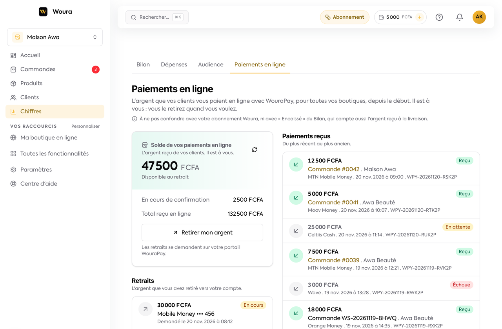
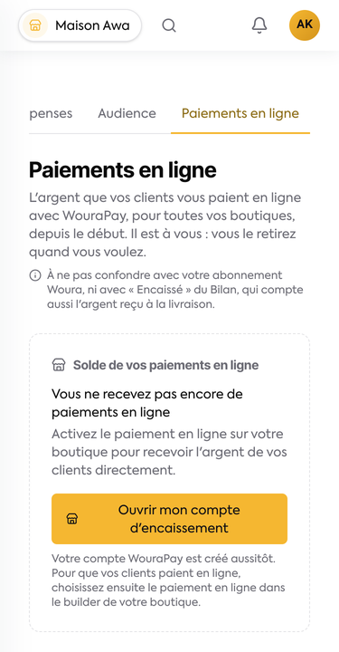
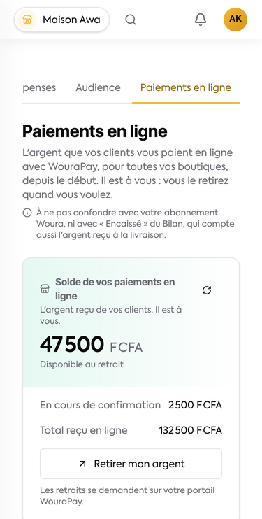
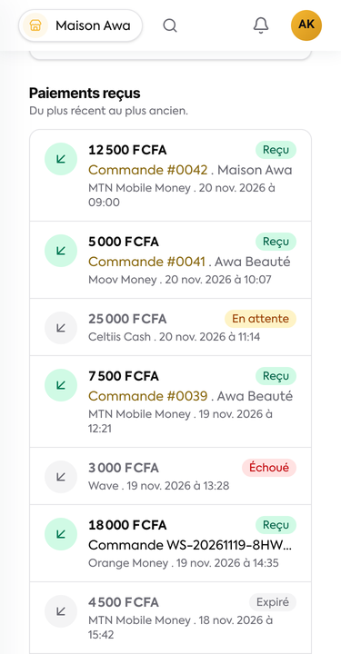
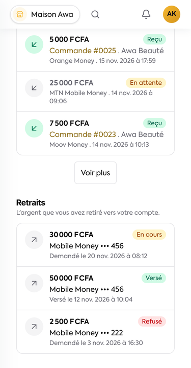

Quand un client paie en ligne, sur votre boutique en ligne ou par l'acompte que demande votre assistant WhatsApp, l'argent arrive sur votre compte **WouraPay**, le service de paiement en ligne de Woura. Cet argent est à vous. La page **Paiements en ligne** vous montre ce compte : ce que vous pouvez retirer, chaque paiement de vos clients avec la commande qu'il règle, et vos retraits.

<Info>
  La page couvre **toutes vos boutiques** et **tout l'historique**, depuis l'ouverture de votre compte. Elle ne dépend ni de la boutique active ni d'une période : vous avez un seul compte WouraPay, quel que soit votre nombre de boutiques.
</Info>

<Frame caption="La page « Paiements en ligne » sur ordinateur : le solde et les retraits à gauche, les paiements reçus à droite.">
  
</Frame>

## À ne pas confondre

L'en-tête de la page le rappelle : « À ne pas confondre avec votre abonnement Woura, ni avec « Encaissé » du Bilan, qui compte aussi l'argent reçu à la livraison. »

| Page | Ce qu'elle montre |
|---|---|
| **Paiements en ligne** | L'argent que vos clients ont payé en ligne avec WouraPay. Il est à vous : vous le **retirez**. |
| **Abonnement et crédits** | Ce que **vous** payez à Woura : votre plan, vos crédits, votre portefeuille. Le portefeuille se recharge, il ne se retire pas. Voir [Comprendre les crédits et votre abonnement](/demarrer/credits-et-abonnement). |
| **Encaissé**, dans le **Bilan** de **Chiffres** | L'argent reçu par la boutique active sur la période choisie, **y compris à la livraison**. Voir [Chiffres et analyses](/application/chiffres). |

## Ouvrir la page

<Tabs>
  <Tab title="Sur ordinateur">
    Cliquez sur **Chiffres** dans le menu, puis sur l'onglet **Paiements en ligne**. C'est le dernier onglet, après **Bilan**, **Dépenses** et, si votre boutique en ligne est publiée, **Audience**.

    La page est aussi dans **Toutes les fonctionnalités**, rubrique **Argent**, carte **Paiements en ligne**. Vous pouvez enfin la chercher par son nom : **Rechercher...** en haut de l'écran, ou ⌘ K sur Mac (Ctrl K sur Windows).
  </Tab>
  <Tab title="Sur téléphone">
    Touchez **Chiffres** dans la barre du bas, puis l'onglet **Paiements en ligne**. Sur un petit écran, les onglets ne tiennent pas tous : faites glisser la barre des onglets pour le trouver.

    Ou touchez **Plus** : **Paiements en ligne** est dans la rubrique **Argent**.
  </Tab>
</Tabs>

Sur cette page, c'est **Chiffres** qui reste en surbrillance dans le menu.

Sur téléphone, la page se lit de haut en bas : le solde, puis **Paiements reçus**, puis **Retraits**. Sur ordinateur, le solde et les retraits sont à gauche, les paiements reçus à droite.

## Ouvrir votre compte WouraPay

Tant que votre compte WouraPay n'existe pas, la page affiche « Vous ne recevez pas encore de paiements en ligne », et ni les paiements ni les retraits.

<Frame caption="Sans compte WouraPay : un bouton suffit à l'ouvrir.">
  
</Frame>

<Steps>
  <Step title="Ouvrez le compte">
    Cliquez sur **Ouvrir mon compte d'encaissement**. Votre compte WouraPay est créé aussitôt, et la page affiche votre solde. Cliquer deux fois ne crée pas deux comptes.
  </Step>
  <Step title="Activez le paiement en ligne">
    Ouvrir le compte ne suffit pas : vos clients ne paient en ligne que si vous le leur proposez. Sur votre boutique en ligne : dans l'éditeur de boutique, **COD & Livraison**, onglet **Paiement**, choisissez **Paiement en ligne uniquement** ou **Au choix du client**. Voir [Commande et livraison](/boutique/commande-et-livraison). Sur WhatsApp : dans les réglages de votre assistant, **Acompte en ligne (WouraPay)**. Voir [L'assistant WhatsApp](/connecter/assistant-whatsapp).
  </Step>
  <Step title="Suivez vos paiements">
    Chaque paiement de vos clients s'affiche dans **Paiements reçus**, et l'argent s'ajoute à votre solde.
  </Step>
</Steps>

Si l'ouverture échoue, Woura affiche « L'ouverture du compte n'a pas abouti. Réessayez dans un instant. »

## Le solde

La carte **Solde de vos paiements en ligne** est lue chez WouraPay à chaque ouverture de la page. Le bouton en forme de flèches, en haut à droite de la carte, la relit sans recharger la page.

<Frame caption="Le solde sur téléphone.">
  
</Frame>

| Ligne | Ce qu'elle dit |
|---|---|
| **Disponible au retrait** (le grand montant) | L'argent que vous pouvez retirer maintenant. |
| **En cours de confirmation** | De l'argent reçu qui n'est pas encore disponible au retrait. La ligne n'apparaît que s'il y en a. |
| **Total reçu en ligne** | Le total reçu en ligne sur votre compte depuis son ouverture. |

Vous recevez des paiements dans plusieurs devises ? Chaque autre devise a sa ligne sous le total, avec son montant disponible.

D'autres messages peuvent apparaître sur la carte :
- **Retraits suspendus** : votre compte est gelé. « Les paiements de vos clients continuent d'arriver ; seuls les retraits sont bloqués. » Le bouton devient **Voir mon portail** ;
- « Vérification d'identité à compléter sur votre portail. » : WouraPay vous demande de prouver votre identité avant certains retraits. Le portail vous guide ;
- « Solde momentanément indisponible » : WouraPay ne répond pas. Réessayez un peu plus tard avec le bouton en forme de flèches.

<Note>
  Vous recommandez Woura ? Vos commissions d'affiliation sont en général versées sur ce même compte WouraPay : elles s'ajoutent alors à ce solde. Voir [Affiliation](/abonnement/affiliation).
</Note>

## Retirer votre argent

Les retraits se demandent sur votre **portail WouraPay**, pas dans Woura. Woura affiche votre solde et vos retraits, mais ne déplace jamais cet argent à votre place.

<Steps>
  <Step title="Ouvrez votre portail">
    Cliquez sur **Retirer mon argent**. Votre portail WouraPay s'ouvre, déjà connecté à votre compte.
  </Step>
  <Step title="Demandez le retrait">
    Sur le portail, choisissez le montant et la destination : Mobile Money, virement bancaire ou crypto.
  </Step>
  <Step title="Suivez-le dans Woura">
    De retour sur **Paiements en ligne**, votre demande s'affiche dans **Retraits**.
  </Step>
</Steps>

<Note>
  Un retrait est retiré de **Disponible au retrait** dès que vous le demandez, avant même d'être versé. Votre argent est réservé : vous ne pouvez pas demander deux fois la même somme.
</Note>

Si le portail ne s'ouvre pas, Woura affiche « Le portail n'a pas pu s'ouvrir. Réessayez dans un instant. »

## Les paiements reçus

**Paiements reçus** liste les paiements de vos clients, du plus récent au plus ancien, toutes boutiques confondues. Vingt s'affichent d'abord ; **Voir plus** affiche les suivants.

<Frame caption="La liste des paiements reçus sur téléphone.">
  
</Frame>

Chaque ligne indique :
- le **montant** du paiement et son **statut** ;
- la **commande** qu'il règle, par exemple **Commande #0042**, suivie du nom de la boutique ;
- le **moyen de paiement** (MTN Mobile Money, Orange Money, Wave…), puis la date et l'heure, à l'heure de votre téléphone ou de votre ordinateur ;
- sur un écran assez large, la référence WouraPay du paiement, qui commence par `WPY-`. Donnez-la au support si vous avez une question sur ce paiement.

Le numéro de la commande est un lien : cliquez dessus pour ouvrir la commande. Si la commande n'existe plus dans **Commandes** (supprimée, par exemple), son numéro s'affiche sans lien. Une commande de votre boutique en ligne peut aussi s'afficher avec le numéro que votre client a reçu, qui commence par `WS-`.

<Note>
  Le numéro de commande s'affiche quand Woura retrouve la commande payée. C'est le cas d'un paiement **Reçu**, une fois que Woura l'a vérifié. Une tentative **En attente**, **Échoué** ou **Expiré** peut s'afficher sans numéro de commande.
</Note>

### Les statuts d'un paiement

| Statut | Ce qu'il veut dire |
|---|---|
| **Reçu** | Le paiement a abouti. |
| **En attente** | Le paiement a commencé, mais votre client ne l'a pas encore terminé. |
| **En cours** | Le paiement est en train d'être traité. |
| **Échoué** | Le paiement n'a pas abouti. Votre client n'a rien payé. |
| **Expiré** | Votre client n'a pas payé à temps. Il n'a rien payé. |
| **Remboursé** | Le paiement a été rendu à votre client. |
| **Annulé** | Le paiement a été annulé. |

Les tentatives **Échoué** et **Expiré** restent dans la liste, et c'est voulu : vous voyez qu'un client a essayé de payer, et vous pouvez le relancer. Elles n'ont rien ajouté à votre solde.

<Warning>
  Avant de livrer une commande payée en ligne, vérifiez que son paiement est **Reçu**. Un client qui dit « j'ai payé » alors que la ligne est **En attente**, **Échoué** ou **Expiré** n'a pas encore payé.
</Warning>

Le montant affiché est celui du paiement. Ce qui arrive sur votre solde peut être un peu moins : la commission de Woura sur les paiements en ligne et d'éventuels frais de paiement en sont retirés. Voir [Comprendre les crédits et votre abonnement](/demarrer/credits-et-abonnement).

## Les retraits

**Retraits** liste l'argent que vous avez retiré vers votre compte, du plus récent au plus ancien. Dix retraits s'affichent d'abord ; **Voir plus** affiche les suivants.

<Frame caption="La liste des retraits sur téléphone.">
  
</Frame>

Chaque ligne indique le **montant**, le **statut**, la **destination** et la date : « Demandé le … », ou « Versé le … » une fois l'argent parti. Pour votre sécurité, la destination ne montre que les trois derniers chiffres du numéro, par exemple **Mobile Money ••• 456**.

| Statut | Ce qu'il veut dire |
|---|---|
| **Demandé** | Votre demande est enregistrée. |
| **Validé** | Votre demande est acceptée. |
| **En cours** | Le versement est en route. |
| **Versé** | L'argent a été versé vers votre destination. |
| **Échoué** | Le versement n'a pas abouti. |
| **Refusé** | Votre demande a été refusée. |

Pour le détail d'un retrait **Échoué** ou **Refusé**, ouvrez votre portail WouraPay avec **Retirer mon argent**.

## Si une liste ne se charge pas

Le solde et les listes sont lus chez WouraPay, rien n'est recopié dans Woura. Si WouraPay ne répond pas, la liste concernée affiche « La liste des paiements est momentanément indisponible. » ou « La liste des retraits est momentanément indisponible. ». Touchez **Réessayer**. Le reste de la page reste utilisable.

## Où est passé l'onglet Encaissements ?

Cette page remplace l'onglet **Encaissements** de la page **Abonnement et crédits**, où l'argent de vos clients se mêlait à ce que vous payez à Woura. Elle montre en plus la liste de vos paiements reçus et de vos retraits.

Un ancien lien vers l'onglet **Encaissements**, dans un favori ou un e-mail, vous mène tout seul à **Paiements en ligne**. C'est vrai aussi pour un ancien lien vers l'onglet **Encaissements** de **Mon compte**.

## Questions fréquentes

<AccordionGroup>
  <Accordion title="Pourquoi ce total n'est-il pas le même que « Encaissé » dans Chiffres ?">
    Ce ne sont pas les mêmes comptes. **Encaissé** porte sur la boutique active et sur la période choisie, et compte aussi l'argent reçu à la livraison. **Paiements en ligne** compte seulement l'argent payé en ligne avec WouraPay, pour toutes vos boutiques, depuis l'ouverture de votre compte.
  </Accordion>
  <Accordion title="Un paiement n'a pas de numéro de commande. Est-ce normal ?">
    Oui, pour une tentative qui n'a pas abouti : un paiement **En attente**, **Échoué** ou **Expiré** peut s'afficher sans commande. Un paiement **Reçu** affiche sa commande dès que Woura l'a vérifié.
  </Accordion>
  <Accordion title="Je vois deux paiements pour la même commande.">
    C'est normal si votre client a payé un acompte, puis le reste en ligne : chaque paiement a sa ligne. Votre client peut aussi avoir essayé une première fois sans succès, puis réessayé.
  </Accordion>
  <Accordion title="Mon solde a baissé, mais mon retrait n'est pas encore versé.">
    C'est normal : la somme est réservée dès votre demande, pour que vous ne la demandiez pas deux fois. Suivez le retrait dans **Retraits** jusqu'à **Versé**.
  </Accordion>
  <Accordion title="Woura peut-il retirer mon argent à ma place ?">
    Non. Les retraits se demandent uniquement sur votre portail WouraPay, avec **Retirer mon argent**. Woura affiche votre solde et vos retraits, rien de plus.
  </Accordion>
  <Accordion title="J'ai plusieurs boutiques. Ai-je plusieurs comptes ?">
    Non. Vous avez un seul compte WouraPay. Les paiements de toutes vos boutiques y arrivent, et chaque ligne de **Paiements reçus** dit de quelle boutique vient la commande.
  </Accordion>
</AccordionGroup>

## Et ensuite ?

<CardGroup cols={2}>
  <Card title="Commande et livraison" icon="truck" href="/boutique/commande-et-livraison">
    Proposer le paiement en ligne ou un acompte.
  </Card>
  <Card title="Paiements d'une commande" icon="wallet" href="/application/paiements-des-commandes">
    Ce que chaque client a payé, et ce qu'il reste à encaisser.
  </Card>
  <Card title="Chiffres et analyses" icon="chart-column" href="/application/chiffres">
    Votre bilan, période par période.
  </Card>
  <Card title="Les modes de paiement côté client" icon="credit-card" href="/boutique/clients/paiement">
    Ce que voit votre client au moment de payer.
  </Card>
</CardGroup>
