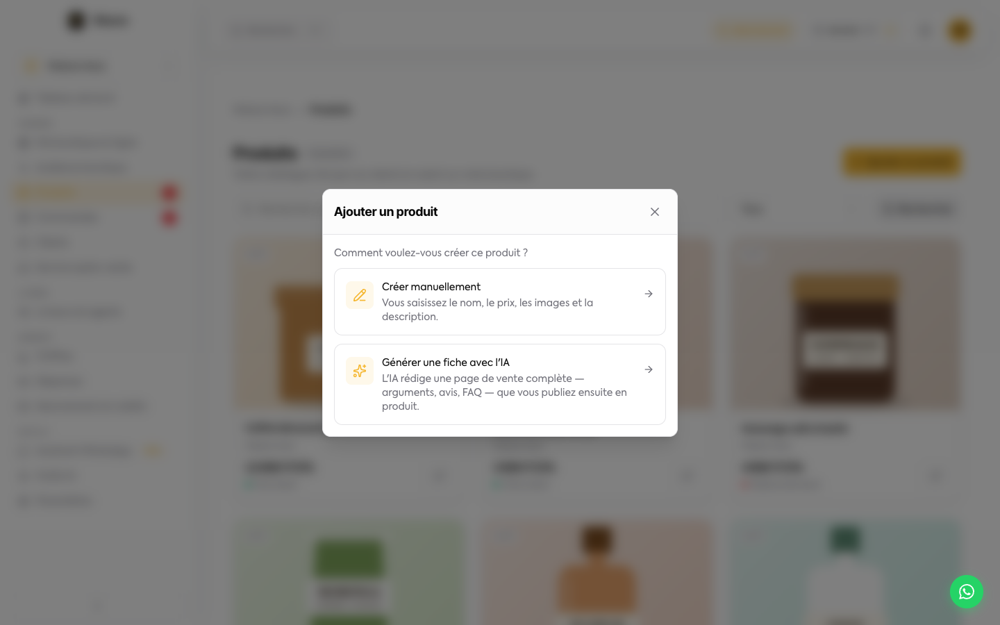

**Produits**, dans le menu ou dans la barre du bas sur téléphone, contient votre catalogue, tel que vos clients le voient sur votre boutique. C'est ici que vous créez et modifiez vos produits, et que vous suivez votre stock.

<Note>
  Pour une boutique Shopify ou WooCommerce, vos produits viennent de la plateforme : modifiez-les plutôt là-bas, puis synchronisez. Voir [Ce qui se synchronise](/connecter/synchronisation).
</Note>

{/* capture à refaire : images/application/produits/01-produits.png */}

Les filtres **Tous**, **Actif**, **Brouillon** et **Archivé** trient vos produits. Le chiffre rouge à côté de **Produits**, dans le menu et dans la barre du bas, compte les produits en rupture.

## Ajouter un produit

Cliquez sur **Ajouter un produit**. Sur téléphone, vous pouvez aussi toucher **Plus**, puis **Produit**. Choisissez ensuite :
- **Créer manuellement** : vous saisissez le nom, le prix, les images et la description ;
- **Générer une fiche avec l'IA** : l'IA rédige une page de vente complète, que vous publiez ensuite en produit. Cette option coûte des crédits. Voir [Fiches produits IA](/application/fiches-produits-ia).

<Frame caption="Les deux façons de créer un produit.">
  
</Frame>

## La fiche d'un produit

Cliquez sur un produit pour ouvrir sa fiche. Deux onglets : **Détails** et **Gestion du stock**.

- **Éditer** modifie le nom, le prix, les photos, la description.
- **Voir la page produit** l'ouvre sur votre boutique.
- **Prix de revient** : ce que le produit vous coûte. Renseignez-le : Woura calcule alors votre bénéfice sur chaque commande.

{/* capture à refaire : images/application/produits/03-detail.png */}

## Gérer le stock

L'onglet **Gestion du stock** montre le stock en **Boutique**, chez vos **Livreurs**, et le **Total**.

- **Ajouter du stock** : un arrivage.
- **Retirer du stock** : une casse, une perte, un échantillon.
- **Stock par livreur** et **Transférer** : le stock confié à vos livreurs.
- **Historique des mouvements de stock** : chaque entrée et sortie.

{/* capture à refaire : images/application/produits/04-stock.png */}

Vous commandez de la marchandise à un fournisseur ? Le lien **Approvisionner ce produit**, dans la fiche, ouvre ses approvisionnements : à la réception, le stock et la dépense s'ajoutent en une seule fois. Voir [Approvisionnement](/application/approvisionnement).

<Tip>
  Réglez un **Seuil de réapprovisionnement** dans **Paramètres** → **Produits** : Woura vous alerte quand un produit descend en dessous.
</Tip>

### Le stock bloque-t-il les ventes ?

Par défaut, **non** : un produit à 0 reste commandable, pour qu'un oubli de mise à jour ne vous fasse pas perdre de vente. Si votre stock est tenu à jour, activez **Bloquer les commandes quand le stock est à 0** dans **Paramètres** → **Produits**. C'est le même réglage que dans l'éditeur de boutique. Voir [Commande et livraison](/boutique/commande-et-livraison).

### Quand le stock sort-il ?

Une pièce payée n'est plus à vendre. Le stock d'une commande sort donc **dès qu'un paiement est vérifié**, sans attendre la livraison. Cette règle vaut pour toutes les boutiques, sans rien à régler.

| Ce qui arrive sur la commande | Le stock sort ? |
|---|---|
| Un paiement en ligne confirmé par WouraPay, total ou acompte | Oui, tout de suite |
| Une capture de paiement par transfert que vous (ou votre agent) validez, total ou acompte | Oui, tout de suite |
| Un paiement que vous enregistrez avec **J'ai vu l'argent arriver**, ou que vous confirmez avec **L'argent est arrivé** | Oui, tout de suite |
| Une capture **à vérifier**, ou un paiement noté avec **Le client dit avoir payé** | Non, pas encore |
| Aucun paiement vérifié | À la livraison, comme avant |

Toute la commande sort d'un coup, même après un simple acompte. Elle ne sort qu'une fois : un second paiement, puis la livraison, ne retirent rien de plus.

Si la commande est **annulée**, **retournée** ou supprimée, le stock revient. En revanche, annuler un paiement ou noter un remboursement ne fait pas revenir le stock : seule la commande le fait.

Dans **Historique des mouvements de stock**, une sortie au paiement se lit « Sorti au paiement de la commande » suivi de son numéro.

<Note>
  Une commande payée avant la mise en place de cette règle sort son stock à la livraison, comme prévu.
</Note>

### Un article vendu dans plusieurs boutiques

Avec plusieurs boutiques, vous pouvez relier le même article d'une boutique à l'autre, puis lui donner un seul stock. La fiche du produit le dit sur la ligne **Article commun**, et la liste marque le produit **Relié**. Voir [Rapprocher vos articles](/application/articles-communs) et [Le stock commun](/application/stock-commun).

## Et ensuite ?

<CardGroup cols={2}>
  <Card title="Produits affichés sur la boutique" icon="eye" href="/boutique/produits-affiches">
    Choisir ce qui apparaît en ligne.
  </Card>
  <Card title="Commandes" icon="shopping-cart" href="/application/commandes">
    Vendre vos produits.
  </Card>
</CardGroup>
